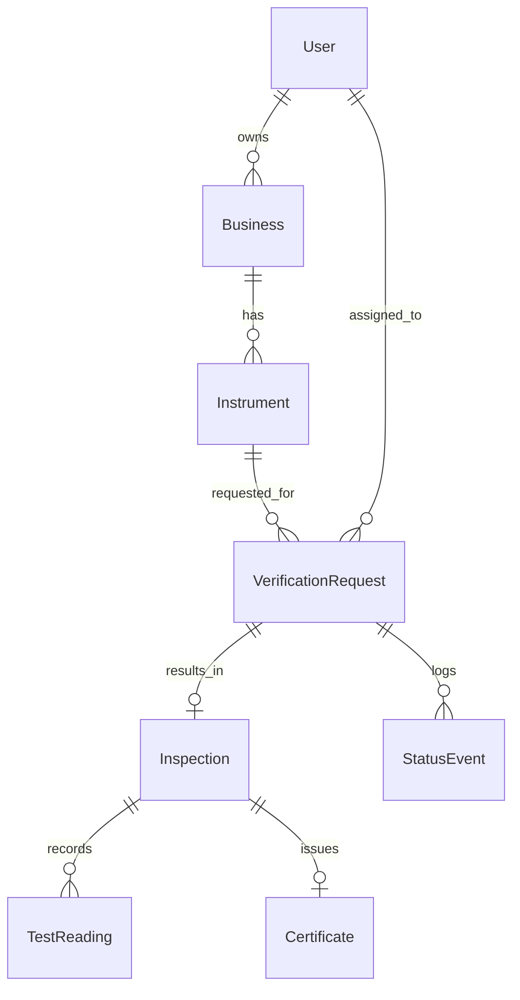
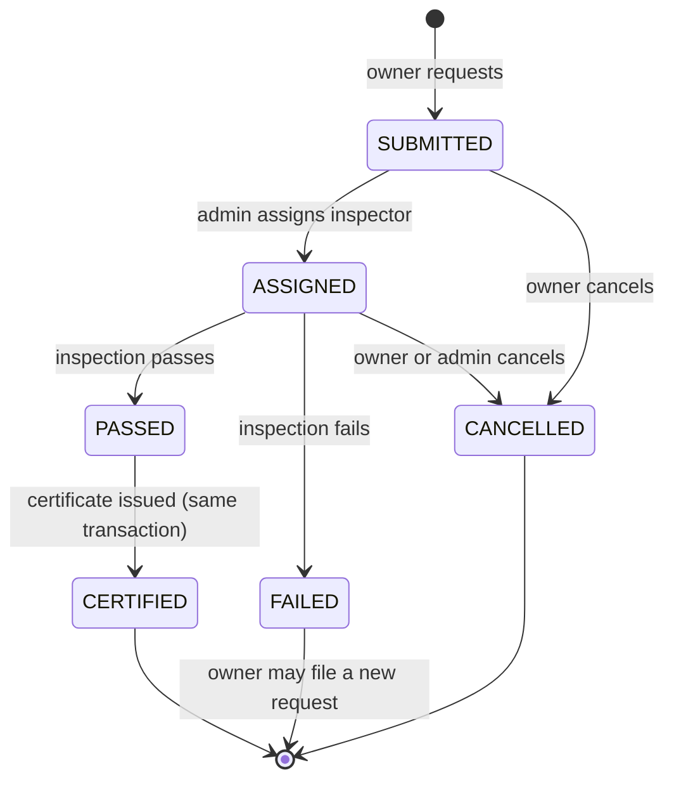

# 2. Architecture and Data Model

## 2.1 Stack

| Layer | Choice | Why |
|---|---|---|
| Language | Python 3.12 | Current, well supported |
| Framework | Django 5.2 LTS | Long-term support, matches typical course material. Use the latest 6.x only if your syllabus requires it |
| Database | SQLite in dev, PostgreSQL optional for deploy | Zero setup for the assignment |
| Templates | Django templates with template inheritance and partials | What the assignment is testing |
| Interactivity | HTMX with `django-htmx` | Live pass or fail and inline forms without writing a SPA |
| Styling | Hand-written CSS with custom properties (tokens), no build step | Precise typography control and no Node toolchain to break |
| Motion | GSAP + ScrollTrigger and Lenis from a CDN | Industry-standard for Awwwards-style sites |
| PDF | ReportLab | Pure Python, installs everywhere, full layout control |
| QR | `qrcode[pil]` | Tiny and reliable |
| Static files | WhiteNoise | Simple deploy |
| Config | `python-decouple` and `.env` | Keeps secrets out of git |
| Tests | Django `TestCase` | No extra tooling |

**Why not Tailwind or React:** Tailwind adds a build step and makes custom typographic systems noisier. React triples the surface area for a one or two day build. HTMX plus server-rendered templates keeps the Django skills visible, which is what you are graded on.

## 2.2 Apps

| App | Responsibility |
|---|---|
| `accounts` | Custom `User` with `role`, login and registration, role mixins |
| `registry` | `Business`, `Instrument`, derived status |
| `verification` | `VerificationRequest`, `Inspection`, `TestReading`, `StatusEvent`, permitted-error rules, service functions |
| `certificates` | `Certificate`, number generation, PDF, QR, public verify views |
| `site_pages` | Landing page, 404 and 500, shared template tags |

> Set `AUTH_USER_MODEL = "accounts.User"` **before the first migration.** Changing it later in Django is painful.

## 2.3 Data model

### User (`accounts.User`, extends `AbstractUser`)
| Field | Type | Notes |
|---|---|---|
| role | CharField choices `OWNER`, `INSPECTOR`, `ADMIN` | default `OWNER` |
| phone | CharField | optional |

### Business (`registry`)
| Field | Type | Notes |
|---|---|---|
| owner | FK User | `limit_choices_to={"role": "OWNER"}` |
| name | CharField | |
| trade_type | CharField choices | grocery, jewellery, fuel, weighbridge, other |
| address, district, pincode | text fields | |
| licence_no | CharField | optional |

### Instrument (`registry`)
| Field | Type | Notes |
|---|---|---|
| business | FK Business | `related_name="instruments"` |
| category | CharField choices | counter scale, platform scale, weighbridge, length measure, capacity measure |
| make, model_no | CharField | |
| serial_no | CharField | `UniqueConstraint(business, serial_no)` |
| max_capacity | Decimal | must be greater than 0 |
| unit | CharField choices | g, kg, t, m, L |
| scale_interval_e | Decimal | verification scale interval *e* |
| accuracy_class | CharField choices | I, II, III, IIII (default III) |
| installed_on | DateField | optional |

Derived (properties, not columns): `current_certificate`, `status`, `days_to_expiry`.

### VerificationRequest (`verification`)
| Field | Type | Notes |
|---|---|---|
| instrument | FK | |
| requested_by | FK User | |
| preferred_date | DateField | |
| status | CharField choices | see state machine |
| inspector | FK User null | `limit_choices_to={"role": "INSPECTOR"}` |
| fee_amount | Decimal | mock, from settings |
| notes | TextField | |
| created_at, updated_at | DateTime | |

### Inspection and TestReading
| Model | Fields |
|---|---|
| `Inspection` | `request` OneToOne, `inspector` FK, `inspected_at`, `zero_ok` bool, `remarks`, `result` (`PASS` or `FAIL`) |
| `TestReading` | `inspection` FK, `kind` (`ACCURACY`, `REPEATABILITY`, `ECCENTRICITY`), `test_load`, `indication`, `error` (computed), `mpe` (computed), `within_limit` (computed) |

### Certificate (`certificates`)
| Field | Type | Notes |
|---|---|---|
| inspection | OneToOne | |
| number | CharField unique | `TOLA-<year>-<6 digit sequence>` |
| token | UUIDField unique, default `uuid4` | public lookup key, never the primary key |
| issued_on, valid_until | DateField | validity from a settings value, default 12 months, confirm with faculty |
| revoked_at, revoked_reason, revoked_by | nullable | |

Derived: `state` is one of `VALID`, `EXPIRED`, `REVOKED`.

### StatusEvent (audit)
`request` FK, `from_status`, `to_status`, `actor` FK, `at`, `note`.

## 2.4 Request state machine

All transitions go through **one service function**, `verification.services.transition(request, to_status, actor, note="")`. It validates the move against an allowed-transitions dict, saves, and writes a `StatusEvent`. Views never set `status` directly. This is the part of the project to be proudest of in the viva.

## 2.5 Permitted-error logic

A single lookup in `verification/rules.py`. Values below are the **simplified initial-verification limits for class III** in units of *e*, based on OIML R 76-1. **Check them against your faculty's material before the viva** and keep the table in one place so a correction is a one-line change.

| Load *m* (in multiples of *e*) | MPE |
|---|---|
| 0 to 500 | ±0.5 e |
| above 500 to 2000 | ±1.0 e |
| above 2000 to 10000 | ±1.5 e |

Error = indication − test load. A reading passes when `abs(error) <= mpe`. An inspection passes only if `zero_ok` is true and every reading is within limit.

## 2.6 URL map

| URL | View | Access |
|---|---|---|
| `/` | Landing | public |
| `/accounts/login/`, `/accounts/logout/`, `/accounts/register/` | Auth | public |
| `/app/` | Role redirect to dashboard | login |
| `/app/instruments/`, `/new/`, `/<pk>/`, `/<pk>/edit/` | Instrument CRUD | owner |
| `/app/requests/`, `/new/?instrument=<pk>`, `/<pk>/` | Requests and timeline | owner |
| `/app/console/requests/`, `/<pk>/assign/` | Assignment | admin |
| `/app/inspector/queue/`, `/requests/<pk>/inspect/` | Inspection | inspector |
| `/app/inspector/requests/<pk>/reading-row/` | HTMX partial: add a reading row | inspector |
| `/app/certificates/<number>/pdf/` | PDF download | owner of instrument, admin |
| `/app/console/certificates/<number>/revoke/` | Revoke | admin |
| `/v/<token>/` | Public verify page | public |
| `/verify/` | Manual number lookup | public |
| `/api/v1/verify/<token>/` | JSON (stretch) | public |
| `/admin/` | Django admin | superuser |

## 2.7 Permissions matrix

| Action | Owner | Inspector | Admin | Public |
|---|---|---|---|---|
| See own instruments | yes | no | all | no |
| Create request | yes | no | yes | no |
| Assign inspector | no | no | yes | no |
| Submit inspection | no | assigned only | no | no |
| Download certificate PDF | own only | no | yes | no |
| Revoke certificate | no | no | yes | no |
| View verify page | yes | yes | yes | yes |

Implementation: `RoleRequiredMixin` in `accounts/mixins.py` plus `get_queryset()` filtering in every view. **Never fetch by bare `pk`** without scoping, otherwise editing the URL exposes someone else's record.

## 2.8 Certificate PDF and QR

- A4 portrait, laid out on the same Swiss grid as the site (see design doc).
- QR encodes `https://<host>/v/<token>/`, with host from a `SITE_URL` setting.
- Fonts are embedded: register Inter Tight and Geist Mono TTFs with ReportLab so the PDF matches the brand.
- Forgery resistance comes from the server lookup. The PDF is only a pointer; the database is the source of truth.

## 2.9 Reminders

`python manage.py send_expiry_reminders` finds certificates expiring in exactly 30 and 7 days and sends email through Django's email backend. In development set `EMAIL_BACKEND` to the console backend. In production run it daily from cron or the host's scheduler.

## 2.10 Settings and secrets

`.env` holds `SECRET_KEY`, `DEBUG`, `ALLOWED_HOSTS`, `SITE_URL`, `VERIFICATION_FEE`, `CERT_VALIDITY_MONTHS`. `.env` is git-ignored; `.env.example` is committed.

## 2.11 Test plan

| Area | Tests |
|---|---|
| State machine | allowed and disallowed transitions, `StatusEvent` written |
| Rules | MPE boundaries at 500e, 2000e and 10000e; zero check failure fails the inspection |
| Permissions | owner A cannot open owner B's instrument or request (expect 404), inspector cannot open an unassigned inspection |
| Certificate | issued on pass, not on fail, number unique, token resolves, revoked shows *Revoked*, past date shows *Expired* |
| Seed | `seed_demo` runs on an empty database without errors |
